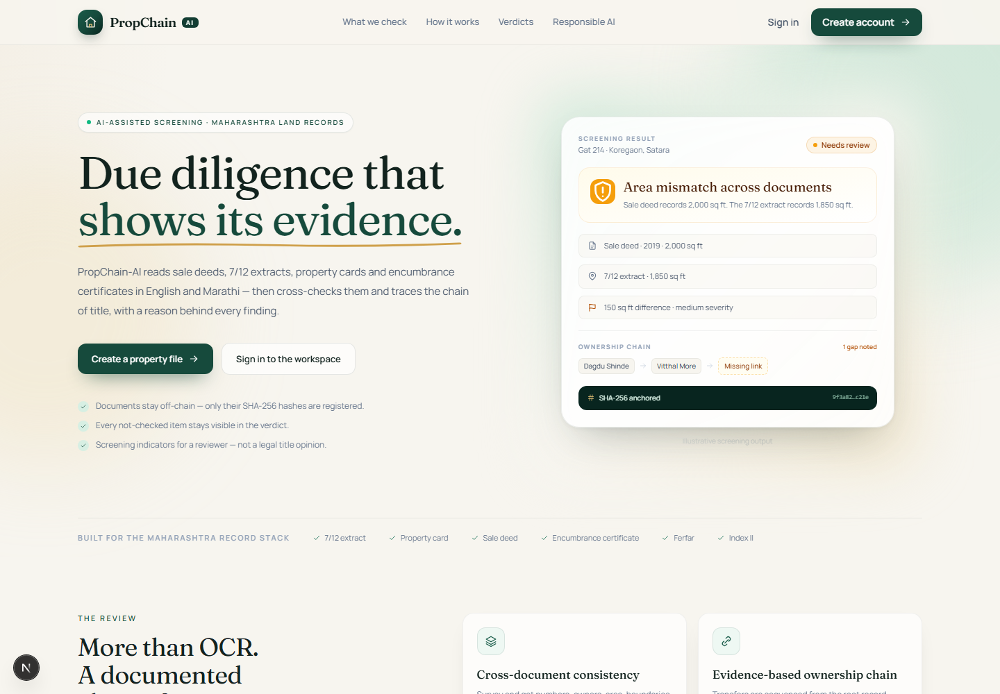
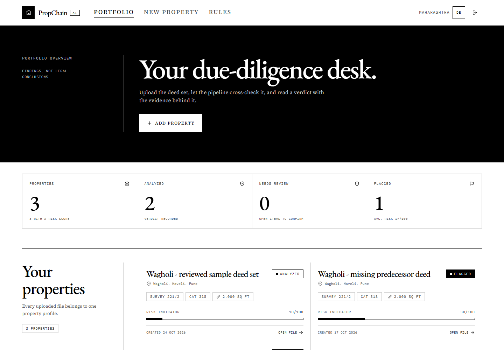
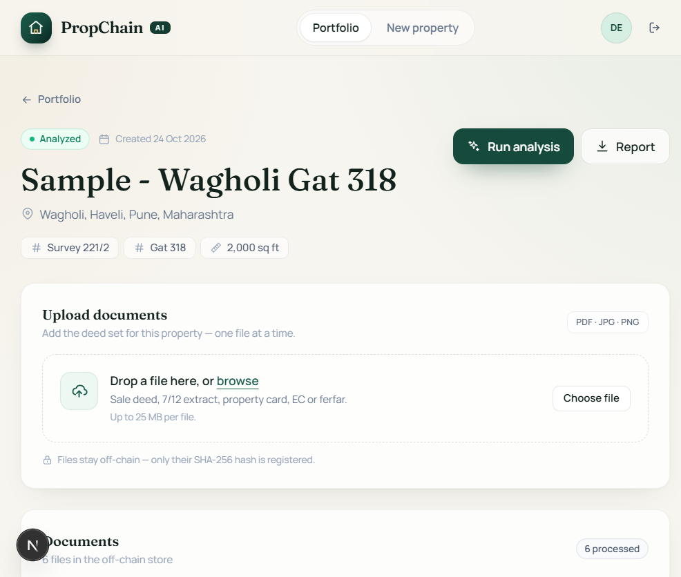
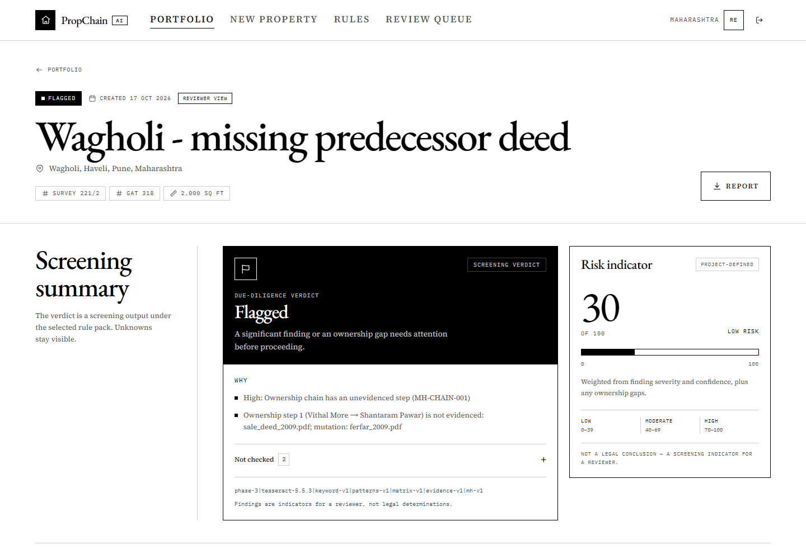

# PropChain-AI

[](https://github.com/vishaalsahani/PropChain-AI/actions/workflows/ci.yml)

**AI-assisted property due diligence for Maharashtra.** Upload a property's documents, get a
document-by-document cross-check, an evidence-based ownership chain, and a screening verdict with
its reasons — and an explicit list of what was **not** checked.

PropChain-AI is an academic prototype. It is a reviewer aid, **not a legal title determination**.

<p align="center">
  <a href="docs/screenshots/landing.png"></a>
  <a href="docs/screenshots/dashboard.png"></a>
</p>
<p align="center">
  <a href="docs/screenshots/property-verified.png"></a>
  <a href="docs/screenshots/property-flagged.png"></a>
</p>

## What it does

- **Extracts** text from digital PDFs and scanned PDF/JPEG/PNG documents (Tesseract OCR).
- **Classifies** 15 Indian property-document types in English and Marathi.
- **Extracts** parties, survey/Gat/CTS numbers, area, registration numbers, dates, consideration,
  boundaries, and other fields with a label/regex pattern pack.
- **Cross-checks** identifiers, names, places, areas, boundaries, dates, registration numbers, and
  document hashes in a pairwise consistency matrix. Every finding cites the documents involved.
- **Builds an ownership chain** from transfer evidence, with ferfar and land-record corroboration;
  unevidenced links are marked as gaps rather than guessed.
- **Applies the `mh-v1` Maharashtra screening pack**: missing 7/12, identifier clashes, chain gaps,
  mortgages, succession, litigation, area, and document-integrity checks.
- **Produces a verdict**: `Verified`, `Needs Review`, or `Flagged`, with machine-readable reasons
  and an explicit *not checked* list.
- **Keeps documents off-chain.** Only SHA-256 hashes are registered; the blockchain adapter is
  mocked by default and can be pointed at a local Hardhat chain.
- **Exports a PDF due-diligence report** for the latest analysis run.

## Status

| Phase | Scope | State |
|---|---|---|
| 0 | Repository foundation, local run path, environment | Complete |
| 1 | Auth, properties, document upload, SHA-256 registry, PDF report | Complete |
| 2 | Real OCR / classifier / field-extraction engines and AC-2 accuracy harness | Complete |
| 3 | Matrix cross-validation, evidence-based ownership, `mh-v1` rule pack, verdict API/UI, AC-3 corpus | Complete |
| 4 | DB-backed, editable rule packs | Next |

Current verification on the development machine:

- **226 backend tests**, 0 failures.
- `AC-3` seeded-error detection: **19/19 (100%)**; both clean controls stay clean; pinned verdicts
  match **6/6**.
- `AC-2` pipeline accuracy: **18/18** document classifications and **136/136** scored fields on the
  labelled corpus.
- Frontend `npm run typecheck` and production `npm run build` pass; **5** Hardhat contract tests pass.

The accuracy numbers are measured on co-designed fixtures; they demonstrate the end-to-end pipeline,
not generalisation to unseen legal wording. The independent acceptance set is later work. See
[`backend/artifacts/phase3_ac3.md`](backend/artifacts/phase3_ac3.md) and
[`backend/artifacts/phase2_accuracy.md`](backend/artifacts/phase2_accuracy.md).

## Quick start (Windows)

### Prerequisites

| Tool | Version | Notes |
|---|---|---|
| Python | 3.12 | the setup script creates `backend\.venv` |
| [uv](https://docs.astral.sh/uv/) | recent | creates the venv and installs backend dependencies |
| Node.js + npm | Node 20+ | Next.js 16 / React 19 and the Hardhat toolchain |
| Tesseract OCR | optional | only needed for scanned images; digital PDFs use their text layer |

### Setup and launch

From a PowerShell prompt:

```powershell
git clone https://github.com/vishaalsahani/PropChain-AI.git
cd PropChain-AI

powershell -ExecutionPolicy Bypass -File scripts\setup.ps1
# setup created backend\.env; edit it and set a local SECRET_KEY

powershell -ExecutionPolicy Bypass -File scripts\start-app.ps1
```

`start-app.ps1` is the one-click development launcher:

1. starts the FastAPI backend on `http://127.0.0.1:8000` (running Alembic migrations first when the
   local database does not exist yet),
2. starts the Next.js dev server on `http://localhost:3000` with `npm run dev`,
3. waits for both to answer, then opens the landing page in the default browser.

It is idempotent: anything already listening is reused. Server logs are written to
`%TEMP%\propchain-logs\`. Pass `-Console` to see progress in the terminal.

Open **<http://localhost:3000>** and register an account. If you are using the review machine's demo
database, the seeded account is `demo@propchainai.com` / `demo1234`; a fresh clone has no seeded user.

### Optional: desktop shortcut

To create a desktop shortcut for the development launcher (using the bundled icon):

```powershell
powershell -ExecutionPolicy Bypass -File scripts\create-shortcut.ps1
```

### Manual launch (two terminals)

```powershell
# terminal 1 — backend
cd backend
.venv\Scripts\python.exe -m alembic upgrade head
.venv\Scripts\python.exe -m uvicorn app.main:app --reload

# terminal 2 — frontend
cd frontend
npm run dev
```

API docs: <http://localhost:8000/docs> · UI: <http://localhost:3000>

To stop the launcher's hidden servers, stop the processes listening on ports 8000 and 3000, or sign
out/reboot. The launcher reuses them on the next click.

## Try the sample documents

The synthetic six-document set in [`docs/samples`](docs/samples) is a clean, internally consistent
Maharashtra chain. Upload all six to a property with:

| Field | Value |
|---|---|
| State / District / Taluka / Village | Maharashtra / Pune / Haveli / Wagholi |
| Survey No. | 221/2 |
| Gat No. | 318 |
| Area | 2000 sq ft |

Expected result: **Verified**, 0 findings, and the chain
`Dagdu Shinde → Vithal More → Shantaram Pawar`.

The files are fictional; see [`docs/samples/README.md`](docs/samples/README.md) for the full test
recipe and the single-document negative test.

## Configuration

Copy `.env.example` to `backend\.env`; `scripts\setup.ps1` does this automatically on a new
checkout. The launcher starts the backend from `backend\`, so `pydantic-settings` reads that file.
Real environment variables override it. For a non-default frontend API URL, create
`frontend\.env.local` with `NEXT_PUBLIC_API_URL`; otherwise the frontend uses
`http://localhost:8000`. Both env files are gitignored.

| Setting | Default | Purpose |
|---|---|---|
| `DATABASE_URL` | `sqlite:///./propchain.db` | SQLAlchemy database URL |
| `SECRET_KEY` | `change-me-in-production` | JWT signing key; change locally |
| `STORAGE_PATH` | `./storage` | Uploaded documents (kept out of git) |
| `BLOCKCHAIN_RPC_URL` | `http://127.0.0.1:8545` | Local EVM endpoint |
| `BLOCKCHAIN_MOCK_MODE` | `true` | Hash-register mock; set `false` for Hardhat |
| `NEXT_PUBLIC_API_URL` | `http://localhost:8000` | Frontend API base URL (`frontend\.env.local`) |
| `TESSERACT_CMD` | unset | Optional path to `tesseract.exe` |
| `TESSDATA_PREFIX` | unset | Optional path to the Tesseract `tessdata` directory |

### Engine selection

Document intelligence sits behind frozen interfaces in
[`backend/app/services/interfaces.py`](backend/app/services/interfaces.py). Select the real engines
per machine in `backend\.env`:

```ini
OCR_ENGINE=tesseract
DOC_CLASSIFIER_ENGINE=keyword
NLP_EXTRACTOR_ENGINE=patterns
CROSS_VALIDATOR_ENGINE=matrix
OWNERSHIP_BUILDER_ENGINE=evidence
RULE_ENGINE=mh_pack
```

| Setting | Values | Code default | Effect |
|---|---|---|---|
| `OCR_ENGINE` | `fake`, `tesseract` | `fake` | Tesseract OCR for scans; digital PDFs use their embedded text layer |
| `DOC_CLASSIFIER_ENGINE` | `fake`, `keyword` | `fake` | Keyword/label fingerprinting across 15 document types |
| `NLP_EXTRACTOR_ENGINE` | `fake`, `patterns` | `fake` | Label/regex pack, English + Marathi (Devanagari numerals, `MH-XXX-YYYY-NNNNN`, survey/Gat/CTS, area units → sqft, consideration) |
| `CROSS_VALIDATOR_ENGINE` | `fake`, `matrix` | `fake` | `matrix-v1` pairwise consistency findings with document citations |
| `OWNERSHIP_BUILDER_ENGINE` | `fake`, `evidence` | `fake` | `evidence-v1` transfer chain with corroboration and gap flags |
| `RULE_ENGINE` | `fake`, `mh_pack` | `fake` | `mh-v1` 12-rule Maharashtra screening pack |

The active selection is visible in `GET /health`. A fresh checkout starts with `fake` so it boots
without Tesseract or OpenCV. Unknown engine names log a warning and fall back to fake; a known engine
whose module cannot be imported fails loudly instead of silently mocking.

### Tesseract (optional)

Only needed for scanned documents. Install it through your package manager, for example:

```powershell
winget install UB-Mannheim.TesseractOCR
# or, with micromamba:
micromamba create -y -p "$HOME\tools\tessenv" -c conda-forge tesseract
```

Then point `.env` at the binary and tessdata directory if they are not on `PATH`:

```ini
TESSERACT_CMD=C:\Program Files\Tesseract-OCR\tesseract.exe
TESSDATA_PREFIX=C:\Program Files\Tesseract-OCR\tessdata
```

If Tesseract is missing entirely, the app still runs; image-only documents are simply not OCR'd.

## Tests and verification

```powershell
# backend: 226 tests, fake engines, isolated temp SQLite databases
cd backend
.venv\Scripts\python.exe -m pytest

# frontend: type check and production build
cd ..\frontend
npm ci
npm run typecheck
npm run build

# contracts (optional)
cd ..\contracts
npm ci
npm run test
```

The backend suite boots the app per test module against its own temp database (migrated with
Alembic) and temp storage directory; no live server is required. Real-engine measurements are run
separately:

```powershell
cd backend
.venv\Scripts\python.exe scripts\accuracy_report.py
.venv\Scripts\python.exe scripts\ac3_report.py
```

## Architecture

```text
PropChain/
├── backend/                 FastAPI API, SQLAlchemy models, Alembic migrations
│   ├── app/services/        OCR, classification, extraction, matrix, ownership, rules, verdict
│   ├── app/routers/         auth, properties, documents, analysis, blockchain, reports, admin
│   ├── tests/               backend test suite
│   └── artifacts/           AC-2 / AC-3 measurement reports
├── frontend/                Next.js 16 + React 19 + Tailwind
│   └── src/app/             landing, auth, dashboard, property workspace
├── contracts/               DocumentRegistry.sol + Hardhat toolchain
├── docs/                    screenshots, synthetic samples, icon assets
└── scripts/                 setup.ps1, start-app.ps1, create-shortcut.ps1
```

Key backend boundaries:

- `backend/app/services/analysis_engine.py` orchestrates the pipeline and persists a run.
- `backend/app/services/verdict.py` maps findings to the fixed verdict vocabulary and the
  *not checked* list.
- `backend/app/routers/analysis.py` exposes the latest run, findings, ownership chain, and verdict.
- `backend/app/services/blockchain.py` (or the router-level adapter) registers SHA-256 hashes;
  documents never leave local storage.

## API

| Method | Endpoint | Purpose |
|---|---|---|
| POST | `/auth/register` | Create account |
| POST | `/auth/login` | Get JWT token |
| POST | `/properties` | Create property |
| GET | `/properties` | List properties |
| GET | `/properties/{id}` | Property workspace data |
| POST | `/documents/upload/{property_id}` | Upload a document and compute its SHA-256 |
| POST | `/analysis/run/{property_id}` | Run the analysis pipeline |
| GET | `/analysis/{property_id}/findings` | Latest findings |
| GET | `/analysis/{property_id}/ownership` | Latest ownership chain |
| GET | `/analysis/{property_id}/verdict` | Verdict, reasons, and not-checked list |
| POST | `/blockchain/register/{document_id}` | Register a document hash |
| POST | `/blockchain/verify/{document_id}` | Verify document integrity |
| GET | `/reports/{property_id}/pdf` | Download the PDF report |
| GET | `/health` | API and active-engine health |

## Responsible AI

- Findings are **screening indicators**, not legal determinations. Final title verification requires
  a qualified professional and the original government records.
- Checks that were not performed are reported as **not checked** — they are never silently treated as
  passing.
- Every finding cites the documents it came from; uncertain ownership links are marked as gaps.
- Documents remain off-chain. Only SHA-256 hashes are registered, and the default chain adapter is a
  mock.
- The accuracy harnesses use synthetic, co-designed fixtures. They are evidence that the pipeline
  works end to end, not a claim of general legal accuracy.
- This is an academic prototype; do not use it as the sole basis for a property transaction.

## Documentation

- [Project specifications](PROPCHAIN-AI%20Specs.pdf)
- [Synopsis](PropChain-AI_Synopsis.pdf)
- [Phase 3 AC-3 report](backend/artifacts/phase3_ac3.md)
- [Phase 2 AC-2 report](backend/artifacts/phase2_accuracy.md)
- [Synthetic sample documents](docs/samples/README.md)
- [Current review deck](PropChain-AI_Review-IV.pptx)

## Docker

The checked-in `docker-compose.yml` is a **legacy Phase 5 placeholder** and is not supported yet
(Docker is not installed on the review machine; the images/ports are not maintained). Use the local
Python/Node path above. A supported container workflow is future work.

## License and attribution

Academic project by **Vishal Sahani**. No open-source license has been added; treat the repository as
an academic prototype unless a license is provided.
