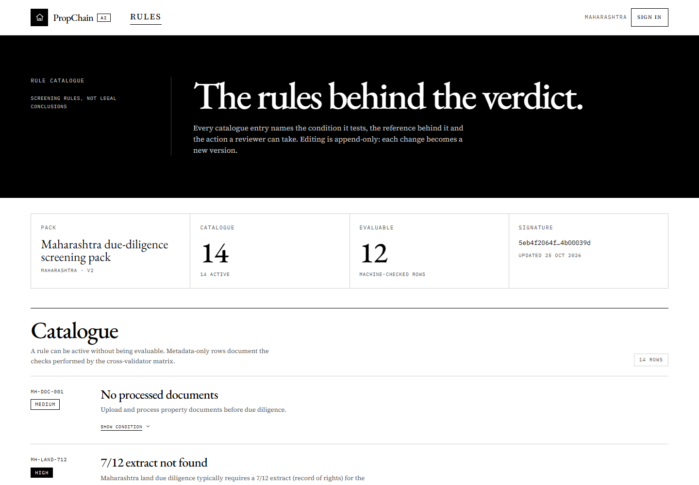
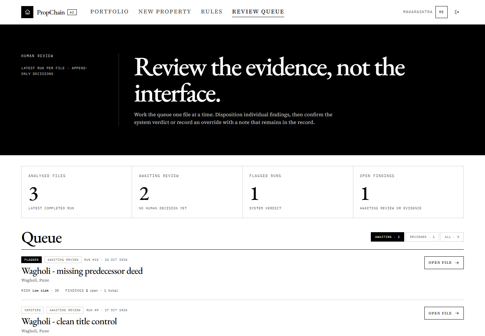
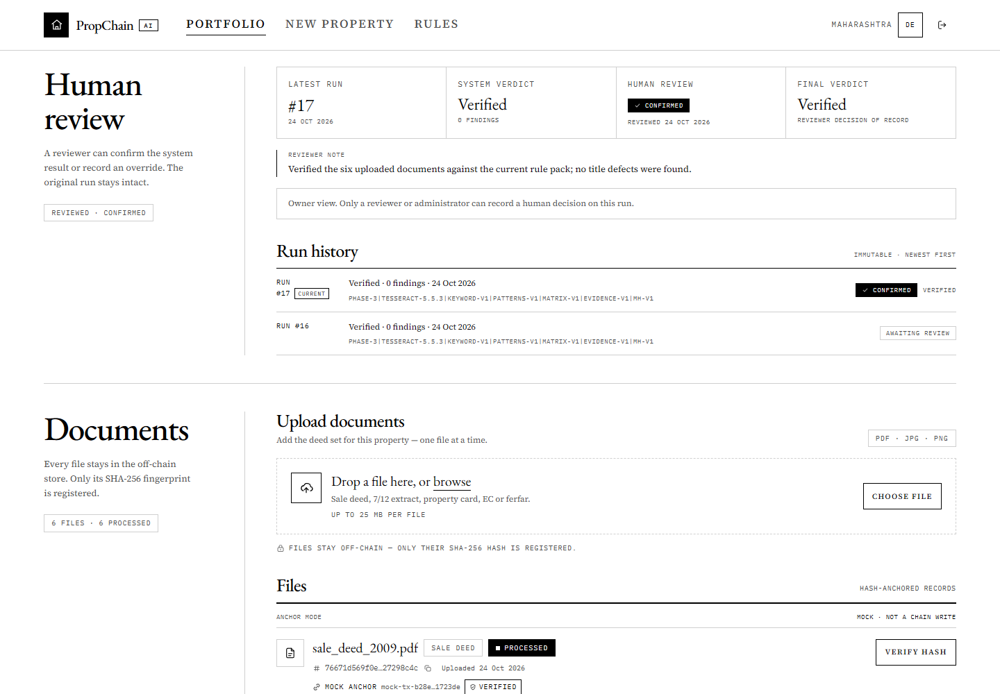
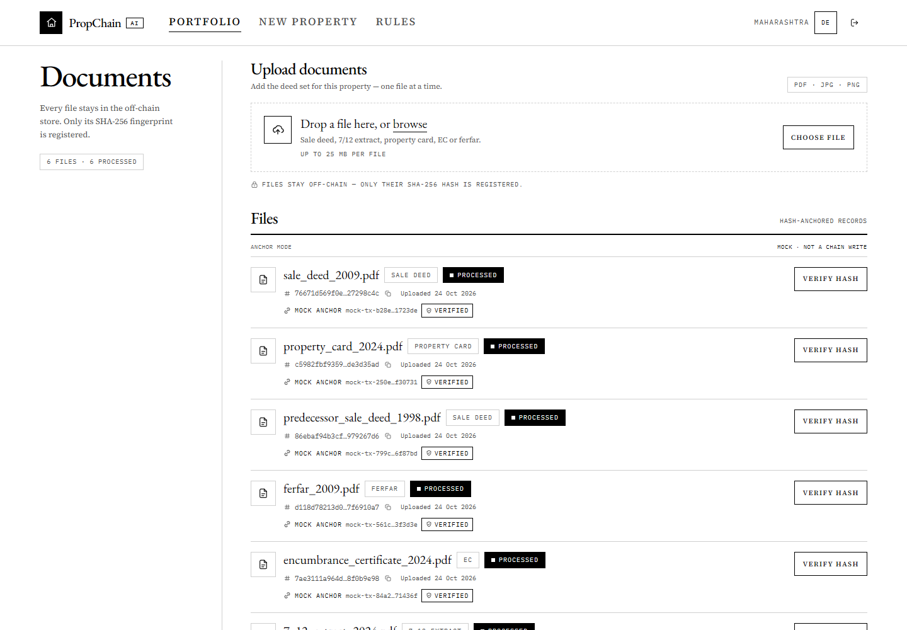

# PropChain-AI

[](https://github.com/vishaalsahani/PropChain-AI/actions/workflows/ci.yml)

**AI-assisted property due diligence for Maharashtra.** Upload a property's documents, get a
document-by-document cross-check, an evidence-based ownership chain, and a screening verdict with
its reasons — and an explicit list of what was **not** checked. Document fingerprints can be
anchored, and a reviewer can confirm or override the screening result with a note that remains in
an immutable history.

PropChain-AI is an academic prototype. It is a reviewer aid, **not a legal title determination**.

<p align="center">
  <a href="docs/screenshots/landing.png"></a>
  <a href="docs/screenshots/dashboard.png"></a>
</p>
<p align="center">
  <a href="docs/screenshots/property-verified.png"></a>
  <a href="docs/screenshots/property-flagged.png"></a>
</p>
<p align="center">
  <a href="docs/screenshots/rules.png"></a>
  <a href="docs/screenshots/review-queue.png"></a>
</p>

## What it does

- **Extracts** text from digital PDFs and scanned PDF/JPEG/PNG documents (Tesseract OCR).
- **Classifies** 15 Indian property-document types in English and Marathi.
- **Extracts** parties, survey/Gat/CTS numbers, area, registration numbers, dates, consideration,
  boundaries, and other fields with a label/regex pattern pack.
- **Cross-checks** identifiers, names, places, areas, boundaries, dates, registration numbers, and
  document hashes in a pairwise consistency matrix. Every finding cites the documents involved.
- **Builds an ownership chain** from transfer evidence, with ferfar and land-record corroboration;
  unevidenced links are marked as gaps rather than guessed.
- **Applies the `mh-v1` Maharashtra screening pack**: missing 7/12, identifier clashes, chain gaps,
  mortgages, succession, litigation, area, and document-integrity checks.
- **Keeps the rule pack editable and versioned.** The public `/rules` catalogue shows what is being
  checked; an admin can edit a rule, roll back to a previous version, or reset the pack. Every
  change is versioned and audited.
- **Produces a verdict**: `Verified`, `Needs Review`, or `Flagged`, with machine-readable reasons
  and an explicit *not checked* list.
- **Registers SHA-256 fingerprints** in mock mode by default or on a real EVM. A missing chain,
  contract, or signer fails closed; the adapter never substitutes a synthetic success for a real
  chain write. File contents stay off-chain.
- **Adds a human review layer**: a reviewer dispositions findings (`open`, `confirmed`,
  `dismissed`, `needs_evidence`), then confirms or overrides the system verdict. Decisions require
  notes, and prior runs and findings remain immutable.
- **Exports a PDF due-diligence report** for the latest analysis run.

## Status

| Phase | Scope | State |
|---|---|---|
| 0 | Repository foundation, local run path, environment | Complete |
| 1 | Auth, properties, document upload, SHA-256 registry, PDF report | Complete |
| 2 | Real OCR / classifier / field-extraction engines and AC-2 accuracy harness | Complete |
| 3 | Matrix cross-validation, evidence-based ownership, `mh-v1` rule pack, verdict API/UI, AC-3 corpus | Complete |
| 4 | DB-backed, editable, versioned rule catalogue and admin editor | Complete |
| 5 | Real EVM document-hash anchoring with fail-closed status and mock default | Complete |
| 6 | Reviewer dispositions, run decisions, audit events, and immutable history | Complete |
| 7 | Release hardening: final verification, documentation, demo reproducibility | Complete |
| 8 | Pilot readiness: independent acceptance set, supported deployment, legal review | Next |

Current verification on the development machine:

- **266 backend tests**, 0 failures.
- `AC-3` seeded-error detection: **19/19 (100%)**; both clean controls stay clean; pinned verdicts
  match **6/6**.
- `AC-2` pipeline accuracy: **18/18** document classifications and **136/136** scored fields on the
  labelled corpus.
- Frontend `npm run typecheck` and production `npm run build` pass; **5** Hardhat contract tests pass.
- A live-API round-trip against a local Hardhat node has been exercised: register, `MATCH`, tampered
  `MISMATCH`, and idempotent re-register. The running demo was restored to mock mode.
- The reviewer workflow, rule versioning, stale-review `409` guard, and read-only reviewer controls
  are covered by backend integration tests and exercised in the browser.

The accuracy numbers are measured on co-designed fixtures; they demonstrate the end-to-end pipeline,
not generalisation to unseen legal wording. The independent acceptance set is later work. See
[`backend/artifacts/phase3_ac3.md`](backend/artifacts/phase3_ac3.md) and
[`backend/artifacts/phase2_accuracy.md`](backend/artifacts/phase2_accuracy.md).

## Quick start (Windows)

### Prerequisites

| Tool | Version | Notes |
|---|---|---|
| Python | 3.12 | the setup script creates `backend\.venv` |
| [uv](https://docs.astral.sh/uv/) | recent | creates the venv and installs backend dependencies |
| Node.js + npm | Node 20+ | Next.js 16 / React 19 and the Hardhat toolchain |
| Tesseract OCR | optional | only needed for scanned images; digital PDFs use their text layer |

### Setup and launch

From a PowerShell prompt:

```powershell
git clone https://github.com/vishaalsahani/PropChain-AI.git
cd PropChain-AI

powershell -ExecutionPolicy Bypass -File scripts\setup.ps1
# setup created backend\.env; edit it and set a local SECRET_KEY

powershell -ExecutionPolicy Bypass -File scripts\start-app.ps1
```

`start-app.ps1` is the one-click development launcher:

1. starts the FastAPI backend on `http://127.0.0.1:8000` (running Alembic migrations first when the
   local database does not exist yet),
2. starts the Next.js dev server on `http://localhost:3000` with `npm run dev`,
3. waits for both to answer, then opens the landing page in the default browser.

It is idempotent: anything already listening is reused. Server logs are written to
`%TEMP%\propchain-logs\`. Pass `-Console` to see progress in the terminal.

Open **<http://localhost:3000>** and register an account. Public registration creates a buyer/owner.
If you are using the review machine's demo database, these accounts are available:

| Role | Email | Password | Can do |
|---|---|---|---|
| Buyer / owner | `demo@propchainai.com` | `demo1234` | Create properties, upload documents, run analysis, anchor hashes, view reports |
| Reviewer | `reviewer@propchainai.com` | `review1234` | Read all properties, review findings and runs; no uploads, analysis, or anchoring |
| Admin | `admin@propchainai.com` | `admin1234` | Reviewer actions plus the `/rules` catalogue editor and audit log |

A fresh clone has no seeded accounts. Provision the privileged demo accounts with:

```powershell
cd backend
.venv\Scripts\python.exe scripts\seed_demo_roles.py
# add --reset-passwords to restore the demo passwords on an existing database
```

The script is idempotent. Public registration cannot create reviewer or admin accounts.

### Optional: desktop shortcut

To create a desktop shortcut for the development launcher (using the bundled icon):

```powershell
powershell -ExecutionPolicy Bypass -File scripts\create-shortcut.ps1
```

### Manual launch (two terminals)

```powershell
# terminal 1 — backend
cd backend
.venv\Scripts\python.exe -m alembic upgrade head
.venv\Scripts\python.exe -m uvicorn app.main:app --reload

# terminal 2 — frontend
cd frontend
npm run dev
```

API docs: <http://localhost:8000/docs> · UI: <http://localhost:3000>

To stop the launcher's hidden servers, stop the processes listening on ports 8000 and 3000, or sign
out/reboot. The launcher reuses them on the next click.

## Try the sample documents

The synthetic six-document set in [`docs/samples`](docs/samples) is a clean, internally consistent
Maharashtra chain. Upload all six to a property with:

| Field | Value |
|---|---|
| State / District / Taluka / Village | Maharashtra / Pune / Haveli / Wagholi |
| Survey No. | 221/2 |
| Gat No. | 318 |
| Area | 2000 sq ft |

Expected result: **Verified**, 0 findings, and the chain
`Dagdu Shinde → Vithal More → Shantaram Pawar`.

The files are fictional; see [`docs/samples/README.md`](docs/samples/README.md) for the full test
recipe and the single-document negative test.

## Reviewer workflow

Reviewers and admins see every property, but only owners can upload documents, start an analysis, or
register a hash. The reviewer path is:

1. Sign in as `reviewer@propchainai.com` and open **`/review`**.
2. The queue lists the latest completed analysis run for each property. Use the
   **Awaiting review**, **Reviewed**, and **All** filters.
3. Open a property to disposition each finding. The allowed states are `open`, `confirmed`,
   `dismissed`, and `needs_evidence`. Dismissals and evidence requests require a note.
4. Record a run decision: `confirmed` keeps the system verdict, while `overridden` requires a final
   verdict. Every decision requires a note.
5. The decision is attached to that run. A re-run creates a new latest run and returns the property
   to the queue; earlier runs and their decisions remain in **Run history**.

Review is latest-run only. Attempting to review a stale finding or run returns `409` rather than
silently mutating history. The owner sees the reviewer note on the property page, while the
reviewer-only decision controls are hidden from them.



## Rule catalogue

The public **`/rules`** page is the catalogue behind the verdict. It currently ships the Maharashtra
pack with **14 rules** (12 machine-evaluable and 2 metadata-only rows). The page shows each
condition, severity, legal reference, recommended action, and the current pack signature.

With an admin account, the same page supports inline editing:

- Creating or updating a rule appends a new `legal_rule_versions` snapshot.
- The client sends an expected version; a concurrent change returns `409`.
- Rollback restores an earlier snapshot as a **new** version, preserving append-only history.
- Reset restores the built-in pack and deactivates custom rows.
- An audit event is written for each create, update, rollback, and reset.
- If no evaluable rules remain, analysis fails with `PACK-EMPTY-001`; it never returns a clean
  verdict from an empty pack.

The DB-backed rule engine is enabled with `RULE_ENGINE=mh_pack`; the engine reads the active rows
instead of a hard-coded list. The active engine selection is visible in `GET /health`.

## Blockchain anchoring

The default mode is **mock**: no node is contacted, an explicitly labelled synthetic transaction id
is stored, and the API reports `mode: "mock"`. Use `GET /blockchain/status` to inspect the current
mode, network, chain id, contract, and account.

Only the document's SHA-256 fingerprint leaves the machine. File contents and extracted text stay
in the off-chain store. Anchoring is an explicit owner action; uploads do not auto-register hashes.

To run against a local Hardhat chain:

```powershell
# terminal 1 — local EVM (keep it running)
cd contracts
npm ci
npm run node

# terminal 2 — deploy the registry
cd contracts
npm run deploy:local
# copy the address from contracts\deployments\localhost.json
```

Set these in `backend\.env` using a funded Hardhat account, then restart the backend:

```ini
BLOCKCHAIN_MOCK_MODE=false
BLOCKCHAIN_NETWORK=hardhat
BLOCKCHAIN_CHAIN_ID=31337
BLOCKCHAIN_CONTRACT_ADDRESS=0x...
BLOCKCHAIN_PRIVATE_KEY=0x...
BLOCKCHAIN_RPC_URL=http://127.0.0.1:8545
# optional
BLOCKCHAIN_TX_TIMEOUT=120
BLOCKCHAIN_GAS_LIMIT=500000
```

Open a property, choose **Anchor hash** for a document, then **Verify hash**. A match returns
`MATCH`; a modified file returns `MISMATCH`. Re-registering the same unchanged hash is idempotent,
while registering a different hash is rejected. A missing node, contract, or signer produces an
error and a failed status; it never falls back to a synthetic success.

To return to the bootable default, set `BLOCKCHAIN_MOCK_MODE=true` and restart the backend.



## Configuration

Copy `.env.example` to `backend\.env`; `scripts\setup.ps1` does this automatically on a new
checkout. The launcher starts the backend from `backend\`, so `pydantic-settings` reads that file.
Real environment variables override it. For a non-default frontend API URL, create
`frontend\.env.local` with `NEXT_PUBLIC_API_URL`; otherwise the frontend uses
`http://localhost:8000`. Both env files are gitignored.

| Setting | Default | Purpose |
|---|---|---|
| `DATABASE_URL` | `sqlite:///./propchain.db` | SQLAlchemy database URL |
| `SECRET_KEY` | `change-me-in-production` | JWT signing key; change locally |
| `STORAGE_PATH` | `./storage` | Uploaded documents (kept out of git) |
| `BLOCKCHAIN_RPC_URL` | `http://127.0.0.1:8545` | Local EVM endpoint |
| `BLOCKCHAIN_MOCK_MODE` | `true` | Hash-register mock; set `false` for Hardhat |
| `BLOCKCHAIN_NETWORK` | `hardhat` | EVM network label (EVM mode only) |
| `BLOCKCHAIN_CHAIN_ID` | `31337` | Expected chain id; a mismatch fails closed |
| `BLOCKCHAIN_CONTRACT_ADDRESS` | unset | Deployed `DocumentRegistry` address |
| `BLOCKCHAIN_PRIVATE_KEY` | unset | Funded signer key; local demos only, never commit |
| `BLOCKCHAIN_TX_TIMEOUT` | `120` | Receipt timeout in seconds |
| `BLOCKCHAIN_GAS_LIMIT` | `500000` | Register transaction gas limit |
| `NEXT_PUBLIC_API_URL` | `http://localhost:8000` | Frontend API base URL (`frontend\.env.local`) |
| `TESSERACT_CMD` | unset | Optional path to `tesseract.exe` |
| `TESSDATA_PREFIX` | unset | Optional path to the Tesseract `tessdata` directory |

### Engine selection

Document intelligence sits behind frozen interfaces in
[`backend/app/services/interfaces.py`](backend/app/services/interfaces.py). Select the real engines
per machine in `backend\.env`:

```ini
OCR_ENGINE=tesseract
DOC_CLASSIFIER_ENGINE=keyword
NLP_EXTRACTOR_ENGINE=patterns
CROSS_VALIDATOR_ENGINE=matrix
OWNERSHIP_BUILDER_ENGINE=evidence
RULE_ENGINE=mh_pack
```

| Setting | Values | Code default | Effect |
|---|---|---|---|
| `OCR_ENGINE` | `fake`, `tesseract` | `fake` | Tesseract OCR for scans; digital PDFs use their embedded text layer |
| `DOC_CLASSIFIER_ENGINE` | `fake`, `keyword` | `fake` | Keyword/label fingerprinting across 15 document types |
| `NLP_EXTRACTOR_ENGINE` | `fake`, `patterns` | `fake` | Label/regex pack, English + Marathi (Devanagari numerals, `MH-XXX-YYYY-NNNNN`, survey/Gat/CTS, area units → sqft, consideration) |
| `CROSS_VALIDATOR_ENGINE` | `fake`, `matrix` | `fake` | `matrix-v1` pairwise consistency findings with document citations |
| `OWNERSHIP_BUILDER_ENGINE` | `fake`, `evidence` | `fake` | `evidence-v1` transfer chain with corroboration and gap flags |
| `RULE_ENGINE` | `fake`, `mh_pack` | `fake` | DB-backed `mh-v1` Maharashtra pack (14 active rules: 12 evaluable, 2 metadata-only) |

The active selection is visible in `GET /health`. A fresh checkout starts with `fake` so it boots
without Tesseract or OpenCV. Unknown engine names log a warning and fall back to fake; a known engine
whose module cannot be imported fails loudly instead of silently mocking.

### Tesseract (optional)

Only needed for scanned documents. Install it through your package manager, for example:

```powershell
winget install UB-Mannheim.TesseractOCR
# or, with micromamba:
micromamba create -y -p "$HOME\tools\tessenv" -c conda-forge tesseract
```

Then point `.env` at the binary and tessdata directory if they are not on `PATH`:

```ini
TESSERACT_CMD=C:\Program Files\Tesseract-OCR\tesseract.exe
TESSDATA_PREFIX=C:\Program Files\Tesseract-OCR\tessdata
```

If Tesseract is missing entirely, the app still runs; image-only documents are simply not OCR'd.

## Tests and verification

```powershell
# backend: 266 tests, fake engines, isolated temp SQLite databases
cd backend
.venv\Scripts\python.exe -m pytest

# frontend: type check and production build
cd ..\frontend
npm ci
npm run typecheck
npm run build

# contracts (5 tests)
cd ..\contracts
npm ci
npm run test
```

The backend suite boots the app per test module against its own temp database (migrated with
Alembic) and temp storage directory; no live server is required. Phase 4–6 coverage includes:

- `test_rules_api.py`: public reads, RBAC, create/update/rollback/reset, version conflicts, audit,
  and a DB-backed analysis run.
- `test_rule_pack.py`: pack validation, coverage, and `PACK-EMPTY-001`.
- `test_blockchain_phase5.py`: mock/EVM modes, fail-closed setup, register/verify, tamper detection,
  and idempotency.
- `test_review_workflow.py`: queue filtering, finding dispositions, run decisions, latest-run
  guards, stale-review `409`, history, and RBAC.

Real-engine measurements and the full-real-chain smoke test are run separately:

```powershell
cd backend
.venv\Scripts\python.exe scripts\accuracy_report.py
.venv\Scripts\python.exe scripts\ac3_report.py
```

The EVM path is not part of the default test suite; it is exercised with the Hardhat runbook above.
The mock mode is the supported bootable default for a fresh checkout.

## Architecture

```text
PropChain/
├── backend/                 FastAPI API, SQLAlchemy models, Alembic migrations
│   ├── app/services/        OCR, classification, extraction, matrix, ownership, rules, review, anchoring
│   ├── app/routers/         auth, properties, documents, analysis, blockchain, reports,
│   │                        admin, rules, admin_rules, review
│   ├── tests/               backend test suite
│   └── artifacts/           AC-2 / AC-3 measurement reports
├── frontend/                Next.js 16 + React 19 + Tailwind
│   └── src/app/             landing, auth, dashboard, property workspace, rules, review
├── contracts/               DocumentRegistry.sol + Hardhat toolchain
├── docs/                    screenshots, synthetic samples, demo runbook, icon assets
└── scripts/                 setup.ps1, start-app.ps1, create-shortcut.ps1
```

Key backend boundaries:

- `backend/app/services/analysis_engine.py` orchestrates the pipeline, evaluates the selected rule
  pack, and persists an immutable run.
- `backend/app/services/rule_store.py` and `rule_pack.py` own the DB-backed catalogue, version
  snapshots, and coverage checks; `rules_mh.py` keeps the built-in pack as the reset seed.
- `backend/app/services/verdict.py` maps findings to the fixed verdict vocabulary and the
  *not checked* list.
- `backend/app/services/blockchain_service.py` implements mock and EVM registration/verification;
  it fails closed when the chain is unavailable.
- `backend/app/services/review.py` and `access.py` centralize reviewer permissions and the
  latest-run review rules.
- `backend/app/routers/analysis.py` exposes the latest run, findings, ownership chain, run history,
  and verdict. `review.py` exposes the queue and decisions; `rules.py`/`admin_rules.py` expose the
  catalogue.

## API

| Method | Endpoint | Purpose |
|---|---|---|
| POST | `/auth/register` | Create a buyer/owner account |
| POST | `/auth/login` | Get a JWT token |
| GET | `/auth/me` | Current user and role |
| POST | `/properties` | Create a property (owner) |
| GET | `/properties` | List properties visible to the caller |
| GET | `/properties/{id}` | Property workspace data |
| POST | `/documents/upload/{property_id}` | Upload a document and compute its SHA-256 (owner) |
| GET | `/documents/property/{property_id}` | List documents and anchor state |
| GET | `/documents/{document_id}` | Document metadata |
| GET | `/documents/{document_id}/extracted` | Extracted fields |
| POST | `/analysis/run/{property_id}` | Run the pipeline and persist a new run (owner) |
| GET | `/analysis/{property_id}/findings` | Latest-run findings |
| GET | `/analysis/{property_id}/ownership` | Latest-run ownership chain |
| GET | `/analysis/{property_id}/runs` | Immutable run history, newest first |
| GET | `/analysis/{property_id}/verdict` | Latest verdict, reasons, and not-checked list |
| GET | `/rule-packs` | Public rule-pack summaries |
| GET | `/rule-packs/{jurisdiction}` | Public catalogue with active rules |
| GET | `/admin/rule-packs/{jurisdiction}` | Admin catalogue and version state |
| GET | `/admin/rule-packs/{jurisdiction}/rules/{rule_code}` | Admin rule detail and history |
| POST | `/admin/rule-packs/{jurisdiction}/rules` | Create a rule |
| PATCH | `/admin/rule-packs/{jurisdiction}/rules/{rule_code}` | Update a rule with optimistic versioning |
| POST | `/admin/rule-packs/{jurisdiction}/rules/{rule_code}/rollback` | Restore a prior rule version |
| POST | `/admin/rule-packs/{jurisdiction}/reset` | Restore the built-in pack |
| GET | `/review/queue` | Reviewer queue for the latest eligible run per property |
| PATCH | `/review/findings/{finding_id}` | Disposition a finding with a note |
| POST | `/review/runs/{run_id}/decision` | Confirm or override the latest run |
| GET | `/blockchain/status` | Current anchoring mode and connection state |
| POST | `/blockchain/register/{document_id}` | Register a document hash (owner) |
| POST | `/blockchain/verify/{document_id}` | Verify a document hash (owner) |
| GET | `/reports/{property_id}/pdf` | Download the PDF report |
| GET | `/admin/audit-events` | Audit trail (admin) |
| GET | `/health` | API, active engines, and chain mode |

## Responsible AI

- Findings are **screening indicators**, not legal determinations. Final title verification requires
  a qualified professional and the original government records.
- Checks that were not performed are reported as **not checked** — they are never silently treated as
  passing.
- Every finding cites the documents it came from; uncertain ownership links are marked as gaps.
- Rule changes are append-only and versioned. A finding keeps the rule version it was evaluated
  against, so a later catalogue edit cannot rewrite the history of an old run.
- A human decision is recorded on the run, not by mutating the system verdict. The reviewer note,
  final verdict, actor, and timestamp remain in the audit trail.
- An on-chain hash proves document integrity at a point in time. It does **not** prove ownership,
  title, or legal validity.
- Documents remain off-chain. Only SHA-256 hashes are registered, and the default chain adapter is a
  mock.
- The accuracy harnesses use synthetic, co-designed fixtures. They are evidence that the pipeline
  works end to end, not a claim of general legal accuracy.
- This is an academic prototype; do not use it as the sole basis for a property transaction.

## Documentation

- [Ten-minute demo runbook](docs/DEMO.md)
- [Project specifications](PROPCHAIN-AI%20Specs.pdf)
- [Synopsis](PropChain-AI_Synopsis.pdf)
- [Phase 3 AC-3 report](backend/artifacts/phase3_ac3.md)
- [Phase 2 AC-2 report](backend/artifacts/phase2_accuracy.md)
- [Synthetic sample documents](docs/samples/README.md)
- [Screenshots](docs/screenshots)
- [Current review deck](PropChain-AI_Review-IV.pptx)

## Docker

The checked-in `docker-compose.yml` is a **legacy container placeholder** and is not supported
(Docker is not installed on the review machine; the images and ports are not maintained). It is
unrelated to Phase 5: Phase 5 in this repository means EVM document-hash anchoring, not
containerization. Use the local Python/Node path above. A supported container workflow is future
work.

## License and attribution

Academic project by **Vishal Sahani**. No open-source license has been added; treat the repository as
an academic prototype unless a license is provided.
